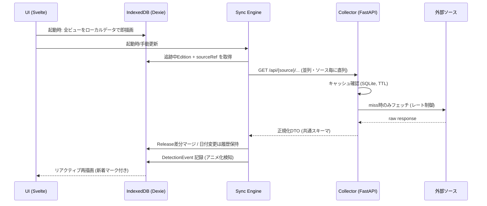

# triptych MVP-Core Design

## Overview

ローカルファーストPWA + 薄い収集プロキシの2層構成。ユーザーデータは全て端末のIndexedDBに保持し、外部ソースへのアクセス（API・スクレイピング）はレート制御とCORS回避を担う自前プロキシ（collector）経由に統一する。フロントは hostra と同系の Svelte + Vite + Tailwind、バックエンドは FastAPI で揃え、既存プロジェクトと運用感を共通化する。

## Tech Stack

| 層 | 技術 | 理由 |
|---|---|---|
| Frontend | Svelte 5 + Vite + TypeScript | hostra と同系。PWA向けに軽量 |
| PWA | vite-plugin-pwa（Workbox） | manifest 生成 + SW precache（FR-007） |
| ローカルDB | IndexedDB + Dexie.js | FR-002。スキーマバージョニングとクエリが素のIDBより堅い |
| スタイル | Tailwind CSS（tailwind-design-system のトークン標準に準拠） | セマンティックトークン + class-based dark mode |
| Backend (collector) | Python FastAPI + httpx | hostra と同系。アダプター実装・レート制御・スクレイピングに適する |
| Backend cache | SQLite | 外部レスポンスのキャッシュのみ（ユーザーデータは持たない） |

## Architecture

### Components

- **UI (Svelte)**: Home / Library / Work詳細 / Calendar / Settings の5ビュー。全描画はIndexedDBのデータのみで完結（外部フェッチは後追い反映）。
- **Store層 (Dexie)**: works / editions / releases / detections / meta の5テーブル。全CRUDの唯一の入口。
- **Sync Engine (client)**: アプリ起動時 + 手動更新で発火。追跡中 Edition の sourceRef を集め、collector へ差分取得を要求し、結果を Store へマージする（FR-004）。
- **Detection Engine (client)**: 同期時に原作系 Edition の正規化タイトルで collector の検索を叩き、未リンクのアニメ一致を DetectionEvent として記録（FR-005）。
- **Collector (FastAPI)**: ソースアダプター群の集約。CORS回避・レート制御・User-Agent明示・SQLiteレスポンスキャッシュ（TTL）を一手に担う。**ユーザーデータは一切保持しない**（ステートレス、キャッシュのみ）。
- **Source Adapters**: `anilist` / `narou` / `openbd` / `ndl` / `syoboi` / `kakuyomu`(scrape)。各自が「取得 → 共通DTOへの正規化 → ソース固有レート制御」を実装（FR-003）。openBD はISBN引き専用のためタイトル検索は持たない。シリーズ新刊のタイトル探索は NDL Search（国会図書館サーチ OpenSearch API）が担い、得たISBNを openBD で詳細化する2段構え。

### Data Flow



### 同期の対象と頻度

- 対象: `status ∈ {plan, active, paused}` の Edition のみ（US-003）。done/dropped は同期しない。
- 頻度: アプリ起動時（前回同期から1時間以上経過時のみ）+ 手動プル。ソース毎に直列、ソース間は並列。
- 失敗時: ソース単位で握りつぶさず `meta.lastSyncErrors` に記録し、UIのステータス行に非侵襲表示（US-005）。
- アニメ Release の粒度: **season-start + 「次話」のローリング更新のみ**（AniList `nextAiringEpisode` を毎同期で上書き）。全話を Release 化するとカレンダーが毎週ノイズで埋まるため、放送済み話は Release として残さない。
- 検知スロットル: アニメ化検知（FR-005）は **Work 毎に24時間に1回まで**。追跡数が増えても同期時間とAniListレートを圧迫しない。照合には AniList の `title.native`（日本語原題）と synonyms を用い、romaji/英題との誤マッチを避ける。

## Data Models

```typescript
type MediaType = 'web-novel' | 'light-novel' | 'manga' | 'anime';
type Status = 'plan' | 'active' | 'paused' | 'done' | 'dropped';
type Source = 'anilist' | 'narou' | 'openbd' | 'ndl' | 'syoboi' | 'kakuyomu' | 'manual';

interface Work {
  id: string;               // nanoid
  title: string;            // 代表タイトル（日本語）
  titleNormalized: string;  // 検知照合用（NFKC・空白/記号除去・小文字化）
  aliases: string[];        // 略称・英題
  coverEditionId?: string;  // 代表カバーに使う Edition
  createdAt: string; updatedAt: string;  // ISO 8601
}

interface Edition {
  id: string;
  workId: string;           // → Work
  mediaType: MediaType;
  title: string;            // Edition固有タイトル（例: 「〜（コミック版）」）
  sourceRefs: SourceRef[];  // 複数ソース紐付け可（anime: anilist+syoboi 等）
  coverUrl?: string;
  status: Status;
  progress?: {              // US-002 現在位置
    unit: 'volume' | 'episode' | 'part';   // 巻 / 話 / なろう部分
    current: number;
    total?: number;
  };
  linkSource: 'auto' | 'manual';  // US-001 リンク由来（検知却下の判定に使用）
  note?: string;
  createdAt: string; updatedAt: string;
}

interface SourceRef {
  source: Source;
  externalId: string;       // ncode / AniList id / ISBN / TID / kakuyomu id
  url: string;
}

interface Release {
  id: string;
  editionId: string;        // → Edition
  kind: 'volume' | 'episode' | 'season-start' | 'stream-start';
  label: string;            // 「第12巻」「第2期 第1話」
  date: string;             // YYYY-MM-DD（時刻不明も許容）
  dateHistory: { date: string; changedAt: string }[];  // 延期履歴 (US-003)
  source: Source;
  seenAt?: string;          // ユーザーが新着マークを確認した時刻
  createdAt: string; updatedAt: string;
}

interface DetectionEvent {   // US-004
  id: string;
  workId: string;
  candidate: {               // 検知されたアニメ
    source: 'anilist';
    externalId: string;
    title: string;
    airingStatus: 'NOT_YET_RELEASED' | 'RELEASING' | 'FINISHED';
    startDate?: string;
  };
  matchScore: number;        // タイトル照合スコア (0-1)
  state: 'pending' | 'accepted' | 'rejected';
  createdAt: string;
}
```

Dexie スキーマ: `works: id, titleNormalized` / `editions: id, workId, status, mediaType` / `releases: id, editionId, date` / `detections: id, workId, state` / `meta: key`。

## API Design (Collector)

全エンドポイントは正規化済み共通DTOを返す。生レスポンスはクライアントへ渡さない。

| Method | Endpoint | Description |
|--------|----------|-------------|
| GET | `/api/search?q=&types=` | 横断検索（FR-006）。anilist + narou (+kakuyomu) を並列に叩き `{source, externalId, mediaType, title, cover, url}[]` を返す |
| GET | `/api/anilist/media/{id}` | アニメ詳細 + relations（原作候補 = US-001）+ 放送予定（nextAiringEpisode） |
| GET | `/api/anilist/detect?title=` | 検知用検索。titleNormalized 照合スコア付きで返す（FR-005） |
| GET | `/api/narou/novel/{ncode}` | なろうAPI: メタデータ・全部分数・最終更新日 |
| GET | `/api/openbd/{isbn}` | 書籍情報・発売日（ISBN引き専用） |
| GET | `/api/ndl/series?title=` | NDL Search でシリーズ新刊を探索し、ヒットしたISBNを openBD で詳細化して返す（新刊 Release 検出） |
| GET | `/api/syoboi/title/{tid}` | しょぼかる: 放送日詳細（AniList補完） |
| GET | `/api/kakuyomu/work/{id}` | スクレイピング: 話数・最終更新（間隔 ≥ 1s、TTLキャッシュ必須） |
| GET | `/api/health` | 死活 + 各アダプターの直近エラー |

### レート制御・キャッシュ

- アダプター毎に token bucket（anilist: 60/min に自主制限、narou: 1 req/s、scrape系: 1 req/s + 同時1）。
- SQLite キャッシュ TTL: 検索 1h / 詳細 6h / scrape 24h。`?refresh=1` で強制更新（手動プル時のみ付与）。
- User-Agent: `triptych/0.1 (personal tracker)` を全リクエストに明示。robots.txt はアダプター初期化時に確認。

## UI Design

**デザイン参照: `~/dev/design/stationery/mono`（BLANK STORE, Monochrome + 1）** — 白×黒×差し色1色、装飾は1px罫線と余白のみ、という規律をトラッカーUIに転用する。トークンは tailwind-design-system 方式で CSS 変数化し class-based dark mode に対応。

```css
:root {
  --bg: #ffffff; --fg: #0a0a0a; --muted: #6a6a6a; --line: #dcdcdc;
  --hi: #eaff00;       /* 差し色: 直近リリース・新着マーク・検知バッジのみに限定使用 */
  --hi-soft: #fffbd1;
}
.dark { --bg: #0d0d0d; --fg: #f2f2f2; --muted: #8a8a8a; --line: #2a2a2a; --hi: #eaff00; }
```

- メディア種別は色分けせず、活字バッジ（`WEB` / `文庫` / `漫画` / `ANIME`）+ 1px枠で区別（mono の節度を維持）。
- **Work詳細 = triptych レイアウト**: 原作（web/紙）・漫画・アニメの Edition を三連画のように横並び（モバイルは縦積み）で対置し、各面にステータス・進捗・次のReleaseを表示。プロダクト名の体現箇所。
- ビュー構成:
  - **Home**: 直近7日の Release（--hi 強調）/ 新着 / 検知通知（pending の DetectionEvent）
  - **Library**: Edition 一覧。status × mediaType フィルタ（US-002）
  - **Work詳細**: triptych 面 + リンク編集（候補提示・手動リンク・付け替え）
  - **Calendar**: 月表示 + リスト表示の切替。dateHistory がある項目に「延期」注記
  - **Settings**: JSON エクスポート/インポート、同期ログ、collector 接続先
- モバイルファースト 375px。FEEDBACK.md の横断教訓を適用: ヘッダー・価格系テキストに `white-space: nowrap`、`overflow-x` 制御、カード整列は aspect-ratio 明示。ja-html-lint + Chrome/Safari/Firefox 検証を完了条件に含める。

## Deployment

- **同一オリジン構成**: collector（FastAPI）がビルド済みPWA（`dist/`）を静的配信し、`/api/*` を同居させる。フロント↔collector 間のCORS設定が不要になり、スマホからは collector のURL一つでアプリ全体に到達できる。
- 開発時: Vite dev server + FastAPI を並走し、Vite の proxy で `/api` を転送。
- スマホ利用: Mac上の collector へ LAN IP または Tailscale 経由でアクセス（`127.0.0.1` バインドがデフォルト、LAN公開時は Bearer トークン必須 — Security 節参照）。iOSでは**ホーム画面追加を前提運用**とする（下記ストレージ保全も参照）。
- **iOS ストレージ保全**: iOS Safari は非利用7日でサイトデータ（IndexedDB含む）を削除しうる。対策として①初回起動時に `navigator.storage.persist()` を要求、②ホーム画面追加を促すUI、③JSONエクスポートの定期リマインドを実装する。

## Error Handling

- **外部ソース障害/レート超過**: アダプターが `SourceUnavailable` を返し、Sync Engine はそのソースをスキップして続行。UIは最終同期時刻とソース別エラーを Settings とホームの細行に表示（US-005）。
- **検知の誤り**: DetectionEvent を `rejected` にすると同一 (workId, externalId) は再検知しない（rejected レコードを照合除外リストとして保持）。
- **リンク誤り**: Edition の workId 付け替えで修正。付け替え時に Release は Edition に追従（editionId 参照のため自動）。
- **IndexedDB スキーマ移行失敗**: Dexie バージョンフックで移行し、失敗時は起動をブロックしてエクスポート導線を提示（データ破壊より機能停止を優先）。
- **collector 未起動**: 全ビューはローカルデータで動作継続。同期ボタンに接続エラーを表示。

## Security Considerations

- MVP は自分専用: collector は `127.0.0.1` バインドをデフォルトとし、LAN公開時は環境変数の共有トークン（`Authorization: Bearer`）を必須化。
- collector はユーザーデータ非保持（プロキシ+キャッシュのみ）のため、漏洩リスクは外部レスポンスキャッシュに限定。
- スクレイピングHTMLは正規化DTOに変換してから返す（生HTML/scriptをクライアントに流さない）。カバー画像URLは外部直リンク表示のみ（保存しない）。
- 入力検証: collector 側で externalId の形式検証（ncode 正規表現・ISBN checksum・数値ID）。

## Testing Strategy

- **Unit (pytest)**: 各アダプターの正規化ロジック（録画済みfixtureレスポンス→DTO）、タイトル正規化・照合スコア、token bucket。
- **Unit (vitest)**: Store層のCRUD・差分マージ（Release日付変更→dateHistory追記）、Detection の accept/reject 遷移。
- **Integration**: Sync Engine ↔ collector をモックサーバーで結合（ソース障害時のスキップ継続を含む）。
- **E2E (手動シナリオ)**: ①検索→Work+Edition登録→triptych表示、②アニメ登録→原作候補提示→リンク、③同期→新刊がカレンダーに新着表示、④なろう追跡作品の検知→accept でアニメEdition生成、⑤オフライン起動→閲覧・編集可、⑥エクスポート→別ブラウザでインポート復元。

## Requirements Coverage

| 要件 | 設計対応 |
|---|---|
| US-001 | Work/Edition モデル + `/api/anilist/media/{id}` relations + リンク編集UI |
| US-002 | Edition.status/progress + Library フィルタ |
| US-003 | Release + dateHistory + Home直近/Calendar + 同期対象規則 |
| US-004 | Detection Engine + DetectionEvent + `/api/anilist/detect` |
| US-005 | Sync Engine + アダプター + エラー非侵襲表示 + 手動編集常時可 |
| FR-001〜007 | 上記各節（モデル/Dexie/アダプター/同期/検知/検索/vite-plugin-pwa） |
| NFR | ローカル即描画・レート制御・エクスポート/インポート・cross-browser 検証 |
